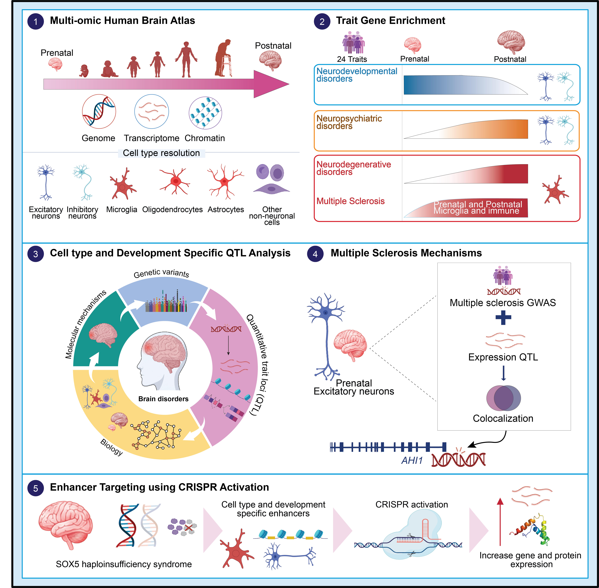

# BrainVar2 analysis code

This repository contains analysis scripts and codes documentation for the
BrainVar study **"Brain disorder mechanisms and therapeutic targets identified from developmental, cell-specific gene regulation"**. Codes are organized by analysis topic. 
See the preprint here: [https://www.biorxiv.org/content/10.64898/2026.11.15.766341v1](https://www.biorxiv.org/content/10.64898/2026.11.15.766341v1)
doi: https://doi.org/10.64898/2026.11.15.766341

  

## Repository map

| Directory | Contents |
|---|---|
| `bulk_RNAseq/` | Bulk RNA-seq alignment, counting, and quality-control scripts |
| `WGS/` | Whole-genome sequencing workflow and documentation |
| `genotype_QC/` | Genotype quality control, ancestry PCA, and QTLtools sample-matching utilities |
| `GWAS/` | MAGMA analysis description and QQ plots |
| `differential_expression/` | RNA cell marker and developmental differential-expression analyses |
| `differential_accessibility/` | Differential-accessibility analyses |
| `trait_enrichment/` | FGSEA, LDSC heritability analyses |
| `biological_domains/` | NMF analysis of similar biological domains |
| `motif_enrichment/` | HOMER input preparation, execution, and result summaries |
| `eQTL/`, `caQTL/`, `sQTL/`, `tensorqtl/` | QTL preparation workflows, and supporting codes |
| `colocalization_finemapping/` | GWAS/eQTL processing, locus plots, colocalization, and fine-mapping |
| `gene_function_category/` | GO-based functional categories and expression plots |
| `cell_cell_communication/` | Donor-level CellChat analyses |
| `gene_regulatory_network/` | GRN inference, locus analyses, visualization, and motif disruption |
| `CICERO/` | CICERO co-accessibility workflow |

See [METHODS_CODE_INDEX.md](METHODS_CODE_INDEX.md) for a manuscript-oriented
map of the available scripts. Folder-specific READMEs describe the relevant workflow. Note: The provided code is intended as a reference for the analyses presented in the manuscript and does not constitute an automated pipeline. Input file names and paths must be adjusted accordingly before running the code.

## Software Dependencies

The repository contains scripts using various R packages, Python packages,
and command-line computational tools. For a summary of software dependencies and licensing information, see
[Software Dependencies](SOFTWARE_DEPENDENCIES.md). For software versions and associated references, please consult the
**Key Resources Table** in the accompanying manuscript. All third-party software and packages remain subject to their respective
licenses and citation requirements.

## License and citation

[MIT License](LICENSE) and third party licenses; check each analysis license separately. If you use this repository, please cite the [associated paper](https://www.biorxiv.org/content/10.64898/2026.11.15.766341v1): 

Brain disorder mechanisms and therapeutic targets identified from developmental, cell-specific gene regulation
Narjes Rohani, Rothem Kovner, Yuting Liu, Antonio Garcia-Guerra, Theodora Markati, Soo-Whee Kim, Yujin Kim, Qi Xu, Emilie M. Wigdor, Jakob Weiss, Joseph L. Lalli, Shan Dong, Anandita Nadkarni, Xuran Wang, Lambertus Klei, Sirisha Pochareddy, Daniel Speckhard-Pasque, Chimmi Dema, Sandra Canosa, Hyesun Cho, Ashley Deveau-French, Gracie Gordon, Michael Griffiths, Karan Jaisingh, Joy Kachko, Pooja Kathail, Mingli Li, Dan Liang, Alicia Ljungdahl, Shaojie Ma, Ruhani Makkar, Nicholas F. Page, Alexa-Nicole Sliby, Menglei Zhang, Xuefang Zhao, Homa Adle-Biassette, Chun Jimmie Ye, Harrison Brand, Michael E. Talkowski, Philip L. De Jager, Donna M. Werling, Matthew J. Girgenti, Carlo Rinaldi, Bernie Devlin, Kathryn Roeder, Nenad Sestan, Stephan J. Sanders
[bioRxiv](https://www.biorxiv.org/content/10.64898/2026.11.15.766341v1) 2026.11.15.766341; doi: https://doi.org/10.64898/2026.11.15.766341

See and cite also:
BrainVar website: [www.brainvar.org](https://brainvar.org)
UCSC Cell Browser interactive visualization and exploration of our snMultiome datasets: [brainvar.cells.ucsc.edu](https://cells.ucsc.edu/?ds=brainvar)
UCSC Genome Browser ATAC-seq tracks: [https://genome-test.gi.ucsc.edu/cgi-bin/hgTrackUi?db=hg38&c=chr7&g=singleCellSignalsPeaks](https://genome-test.gi.ucsc.edu/cgi-bin/hgTrackUi?db=hg38&c=chr7&g=singleCellSignalsPeaks)

For information about data availability and access,
please refer to the Data Availability section of the
BrainVar manuscript.

